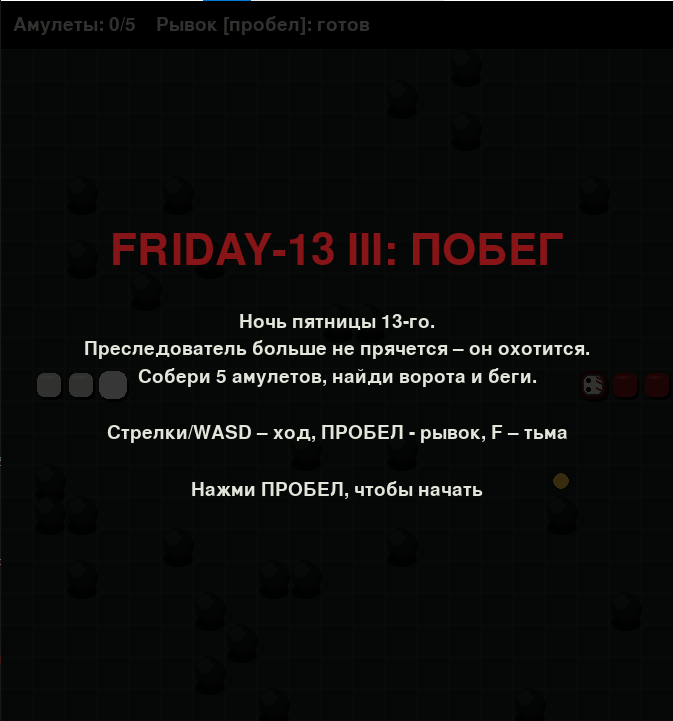
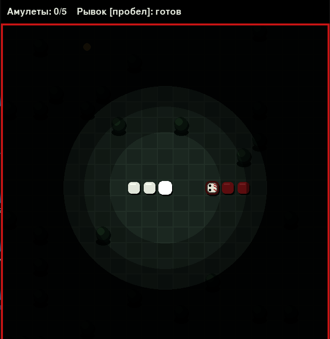
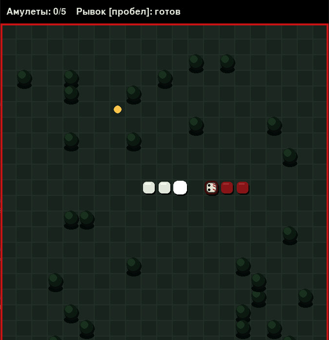
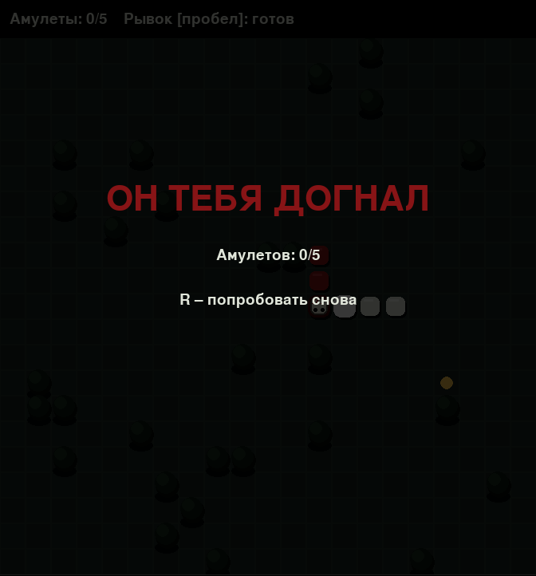
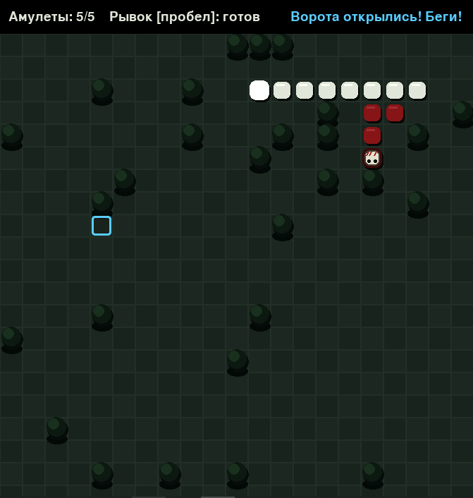
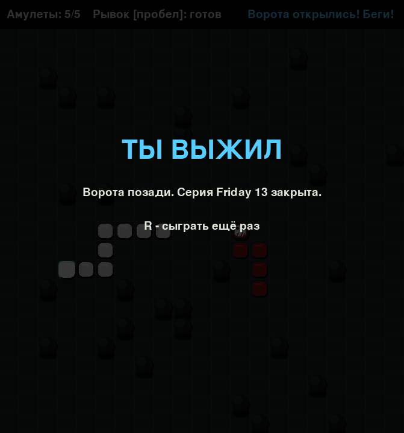

# Friday 13 – III


* **ID:** NS-022
  
* **Status:** Product

> **A survival horror snake game.** The night of Friday the 13th. A relentless hunter stalks the camp. Collect the amulets, open the gate, and escape – or become another name on the list.

## 📖 Overview

* Friday the 13th. A dark camp. Something is moving between the trees, and it is not looking for a conversation.

* **Friday 13 - III** is a grid-based survival game built on classic snake mechanics. The player controls a snake-like figure moving through a fog-covered forest, hunting for amulets scattered across the map. Every amulet collected brings the player closer to the open gate – and makes the hunter faster.

* The hunter is not mindless. It tracks the player using pathfinding and grows every time enough time passes. What starts as a slow, distant threat turns into a predator that moves faster than the player. The forest is the only ally: trees block the hunter's path, but not yours.

* The project is built with **Pygame** and focuses on tight, readable game feel: a small grid, a limited set of mechanics, and tension created by fog, soundless proximity, and an enemy that learns the shortest route to you.

## 🎯 Project Goal

* Create a small, complete, atmospheric game built around a single clear idea: **collect, survive, escape**.

* Combine classic snake mechanics with real-time pathfinding AI in a way that feels fair rather than punishing.

* Deliver a finished, playable experience with a clean presentation: custom palette, animated fog, HUD, menu, and end screens.

## 🎮 Gameplay

* The player moves on a 21×21 grid. Movement is discrete and timed – the snake advances one cell per step.

* Scattered across the map are **amulets**. Each amulet collected:
  - increases the score,
  - speeds up the hunter,
  - and moves the player closer to the gate.

* When all amulets are collected, the **gate** opens somewhere on the map. Reaching it wins the game.

* The hunter follows the player using BFS pathfinding, recalculated at every step. It grows in length every few seconds, and its speed increases with each amulet collected.

* Contact with the hunter, with a tree, or with the player's own body ends the run.

## 🕹 Controls

| Key                     | Action                          |
| ----------------------- | ------------------------------- |
| Arrow keys / `WASD`     | Move                            |
| `Space`                 | Dash (short burst of speed)     |
| `F`                     | Toggle fog of war               |
| `Esc`                   | Return to main menu             |
| `R`                     | Restart after death or victory  |

## ✨ Key Features

### 1. Fog of War

* A circular light radius surrounds the player, revealing only a small portion of the map.
  
* The gate glows faintly even through the fog once it is opened.
  
* Fog can be toggled off with `F` for players who prefer full visibility.

### 2. Pathfinding Hunter

* The hunter uses **breadth-first search** on the grid to find the shortest path to the player.
  
* If the direct path is blocked (by trees or by the player's body), the hunter falls back to a greedy step toward the player.
  
* The hunter **grows in length every 9 seconds** and **speeds up with every amulet collected**, turning a slow chase into a genuine survival situation.

### 3. Dash Mechanic

* A short burst of speed triggered by `Space`.
  
* Has a cooldown of 5 seconds, shown in the HUD.
  
* The only reliable way to break line-of-sight when the hunter is faster than the player.

### 4. Atmospheric Presentation

* Custom dark-forest palette: layered greens for the ground, deep shadows for trees, warm gold for amulets, cold blue for the gate.
  
* Trees are drawn as small volumetric objects – shadow, trunk, crown, and highlight – instead of flat circles.
  
* The hunter wears a hockey mask that **rotates to face its direction of movement**.
  
* A red frame appears around the screen when the hunter gets close, acting as a proximity warning.

### 5. HUD and Game States

* Live HUD showing amulets collected and dash cooldown.
  
* Dedicated screens for the main menu, death, and victory.
  
* Instant restart with `R`, instant return to menu with `Esc`.

## 🧠 How It Works

The game runs a simple fixed-timestep loop:

1. **Input** – the player's desired direction is recorded from keyboard events.
   
2. **Player step** – every `PLAYER_MS` milliseconds the player advances one cell (or faster during a dash). Collisions are checked here.
   
3. **Hunter step** – every `jason_interval()` milliseconds the hunter computes a BFS path to the player and advances one cell. Collisions with the player end the run.
   
4. **Growth timer** – every `JASON_GROW_EVERY` milliseconds the hunter gains a pending growth tick, which extends its body on the next step.
   
5. **Rendering** – the ground, trees, entities, fog, proximity warning, HUD, and overlay are drawn in order.

The hunter's speed is derived directly from the number of amulets collected:

```python
def jason_interval(self):
    return max(90, 190 - 7 * self.got)
```

So the difficulty curve is fully player-driven: every amulet is a step forward and a reason for the hunter to move faster.

## 🛠 Technology Stack

| Technology    | Purpose                                   |
| ------------- | ----------------------------------------- |
| Python        | Core language                             |
| Pygame        | Rendering, input, and the main game loop  |
| `collections` | BFS queue for the hunter's pathfinding    |
| `random`      | Tree, amulet, and gate placement          |

## 💻 How to Run

1. Go to the [**Releases**](https://github.com/NebulaStack-prog/Friday-13-III/releases/tag/v1.0.0) section of this repository.
   
2. Download the latest version of **`Friday13-III.exe`**.

## ⚙ Configuration

All gameplay parameters are defined as constants at the top of `main.py`:

| Constant            | Meaning                                          |
| ------------------- | ------------------------------------------------ |
| `COLS`, `ROWS`      | Grid dimensions                                  |
| `CELL`              | Pixel size of a single cell                      |
| `NEED`              | Amulets required to open the gate                |
| `WALLS`             | Number of trees on the map                       |
| `LIGHT_R`           | Radius of the fog light around the player        |
| `PLAYER_MS`         | Milliseconds between player steps                |
| `DASH_MS`           | Milliseconds between player steps during a dash  |
| `DASH_TIME`         | Total dash duration                              |
| `DASH_CD`           | Dash cooldown                                    |
| `JASON_GROW_EVERY`  | Milliseconds between hunter growth ticks         |

## 📷 Screenshots













© NESTIMS
